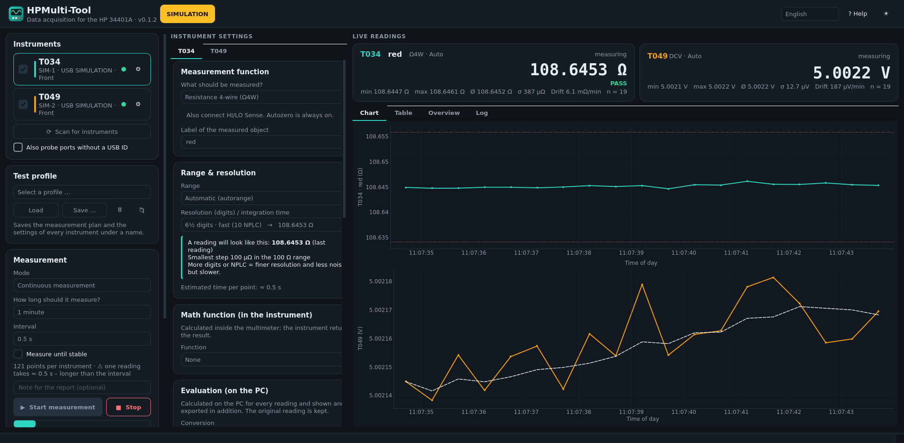

# HPMulti-Tool

Desktop-Anwendung zur Messdatenerfassung mit **HP / Agilent / Keysight 34401A** über RS-232.
Läuft unter Linux und Windows (Python 3.10+, Qt/PySide6). Oberfläche auf Deutsch und Englisch.

*English version: [README.md](README.md)*



## Funktionen

- Ein oder mehrere Multimeter gleichzeitig – was angeschlossen ist, wird automatisch erkannt
- Alle Messfunktionen des 34401A mit ihren Einstellungen per Dropdown
  (Bereich, Digits/NPLC, Autozero, Eingangswiderstand, AC-Filter, Gate-Zeit)
- Auflösungs-Vorschau: zeigt für jede Digits-Einstellung, wie ein Messwert aussieht
- Math im Gerät: Null, Min/Max/Mittelwert, dB, dBm, Grenzwerttest
- Auswertung am PC: lineare Umrechnung mit eigener Einheit, Wert pro Leitungslänge,
  Pt100/Pt1000-Temperatur, Toleranzprüfung (i. O./n. i. O.), gleitender Mittelwert, Drift
- **Messreihe (Loop)**: mehrere Objekte nacheinander messen, z. B. die Adern eines Kabels
  (rot, gelb, schwarz, …) – mit Anschlusshinweis, Wiederholen/Überspringen und Übersichtstabelle
- **Messen bis stabil**: jedes Gerät hört auf, sobald seine letzten N Messwerte innerhalb einer
  Grenze liegen; deren Mittelwert ist der Endwert
- **Prüfprofile**: komplette Einrichtung (Messablauf + Einstellungen aller Geräte) unter einem
  Namen speichern und laden
- Live-Anzeige, Diagramm (Uhrzeit auf der x-Achse, Export als PNG), Tabelle, Übersicht
- **Live-Modus**: virtuelles Frontpanel pro Gerät – Tasten für Funktion, Bereich und Auflösung,
  Null, Autozero, laufende Min/Max/Ø-Anzeige, rollendes Diagramm; jederzeit aufnehmen
- Export als `.csv` (deutsches oder internationales Format) und `.txt`-Protokoll;
  jede Messung wird zusätzlich fortlaufend automatisch gesichert
- Geräte werden über eine im Gerät gespeicherte Kennung identifiziert – unabhängig vom COM-Port;
  die Kennung lässt sich in den erweiterten Einstellungen ändern (mit automatischer Sicherung)
- Modi ohne Messwerterfassung (z. B. Durchgang, Diode): Gerät umschalten und an die Frontplatte
  übergeben
- Eingebaute Hilfe (F1)

## Start

**Linux**

```bash
./start.sh
```

Beim ersten Start wird automatisch eine Python-Umgebung (`.venv`) mit den Abhängigkeiten
angelegt. `./install-desktop-entry.sh` fügt einen Eintrag ins Anwendungsmenü ein.
Voraussetzungen: Benutzer in der Gruppe `dialout`; auf X11-Desktops braucht Qt
`libxcb-cursor0` (`sudo apt install libxcb-cursor0` – `start.sh` weist darauf hin).

**Windows**

Python 3 von python.org installieren, dann `start.bat` doppelklicken.

**Ohne Hardware:** `./start.sh --simulate` bzw. `start.bat --simulate` startet mit zwei
simulierten Multimetern. `--lang de` / `--lang en` wählt die Sprache (auch im Fenster umschaltbar;
Standard ist die Systemsprache).

## Geräte anschließen

- Multimeter: `Shift` › `I/O MENU` › Schnittstelle **RS-232**, **9600 Baud**, **Even / 7 Bit**
  (Werkseinstellung).
- Kabel: Nullmodem (z. B. USB-RS232-Nullmodem-Adapter mit FTDI-Chip).
- Die Schnittstelle nutzt DTR/DSR-Handshake: nach jedem Befehl meldet das Gerät 20–400 ms
  „beschäftigt“. Windows-Treiber warten darauf selbst, Linux-Treiber nicht – das Tool wartet
  deshalb auf beiden Systemen in Software.

## Bedienung

1. **Geräte** – beim Start und mit *Geräte suchen* (F5). Per Haken wählen, welche Geräte messen.
   ⚙ öffnet die erweiterten Einstellungen (Kennung, Selbsttest, Fehlerspeicher, …).
2. **Geräteeinstellungen** – pro Gerät ein Reiter. Es werden nur Optionen angezeigt, die zur
   gewählten Funktion passen. Die Einstellungen werden pro Gerätekennung gespeichert.
3. **Messablauf** – *Fortlaufende Messung* (Dauer oder unbegrenzt, Intervall) oder
   *Messreihe (Loop)* mit Objektliste, dann *Messung starten*.
4. **Export** – nach der Messung als `.csv` oder `.txt`.

Das Hilfefenster (F1) erklärt alle Funktionen ausführlich.

### Dateien

| Was | Linux | Windows |
|---|---|---|
| Autosave | `~/.local/share/HPMulti-Tool/measurements` | `%APPDATA%\HPMulti-Tool\measurements` |
| Kennungs-Sicherungen | `~/.local/share/HPMulti-Tool/calibration_backups` | `%APPDATA%\HPMulti-Tool\calibration_backups` |
| Prüfprofile | `~/.local/share/HPMulti-Tool/profiles` | `%APPDATA%\HPMulti-Tool\profiles` |
| Einstellungen | `~/.config/HPMulti-Tool/HPMulti-Tool.conf` | Registry `HKCU\Software\HPMulti-Tool` |

## Entwicklung

Siehe [README.md](README.md#development). Texte im Code sind englisch; die deutsche
Übersetzung steht in `hpmultitool/i18n_de.py`.

## Lizenz

HPMulti-Tool ist freie Software: Sie darf unter den Bedingungen der GNU General Public License,
Version 3 oder (nach Wahl) jeder späteren Version, weitergegeben und verändert werden. Siehe
[LICENSE](LICENSE).

HP, Agilent und Keysight sind Marken ihrer jeweiligen Inhaber. Dieses Projekt steht in keiner
Verbindung zu ihnen.
