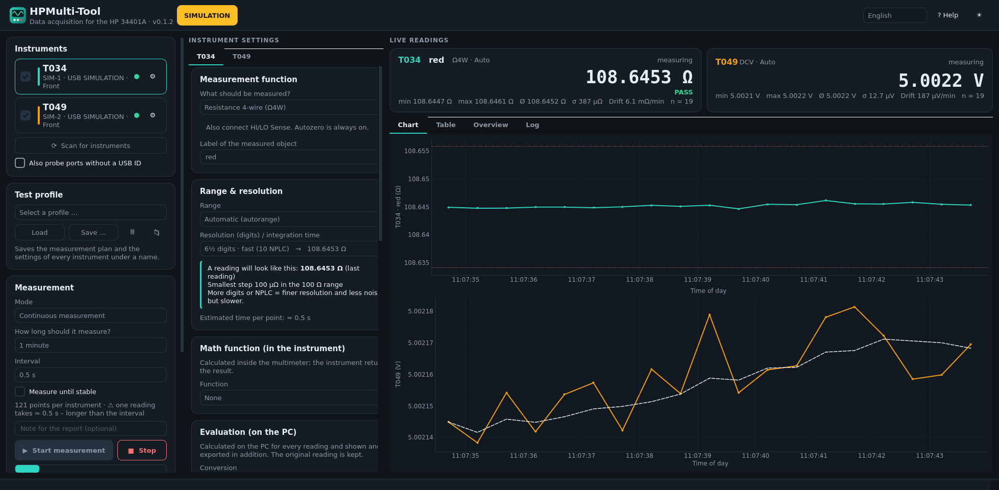
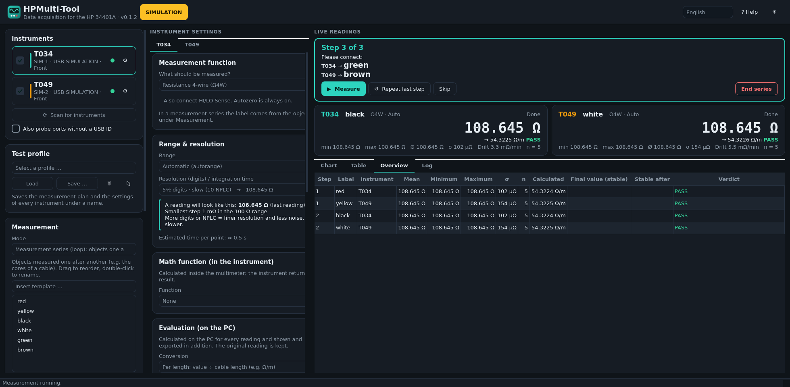

# HPMulti-Tool

Desktop application for data acquisition with **HP / Agilent / Keysight 34401A** multimeters
over RS-232. Runs on Linux and Windows (Python 3.10+, Qt/PySide6). User interface in English and
German.

*Deutsche Fassung: [README.de.md](README.de.md)*



## Features

- One or several multimeters at the same time – whatever is connected is detected automatically
- All measurement functions of the 34401A with their settings in drop-down lists
  (range, digits/NPLC, autozero, input resistance, AC filter, gate time)
- Resolution preview: shows how a reading will look for every digits setting
- Math in the instrument: null, min/max/average, dB, dBm, limit test
- Evaluation on the PC: linear conversion with custom unit, value per cable length,
  Pt100/Pt1000 temperature, tolerance check (pass/fail), moving average, drift statistics
- **Measurement series (loop)**: measure several objects one after another, e.g. the cores of a
  cable (red, yellow, black, …), with prompts, repeat and skip, and a summary table
- **Measure until stable**: each instrument stops when its last N readings are within a limit;
  the mean of these readings is the final value
- **Test profiles**: save and load a complete setup (plan + settings of every instrument) by name
- Live display, chart (time of day on the x axis, export as PNG), table, summary
- **Live mode**: virtual front panel per instrument – function, range and resolution keys, null,
  autozero, live min/max/average, rolling chart; record at any time
- Export as `.csv` (German or international format) and as a `.txt` report;
  every measurement is also autosaved continuously
- Instruments are identified by an ID stored in the instrument – independent of the COM port;
  the ID can be changed in the advanced settings (with automatic backup)
- Modes without data logging (e.g. continuity, diode): switch the instrument and hand it back to
  the front panel
- Built-in help (F1)



## Getting started

**Linux**

```bash
./start.sh
```

The first start creates a Python environment (`.venv`) with the dependencies.
`./install-desktop-entry.sh` adds an entry to the application menu.
Requirements: the user must be in the `dialout` group; on X11 desktops Qt needs
`libxcb-cursor0` (`sudo apt install libxcb-cursor0` on Debian/Ubuntu – `start.sh` tells you if it
is missing).

**Windows**

Install Python 3 from python.org, then double-click `start.bat`.

**Without hardware:** `./start.sh --simulate` (or `start.bat --simulate`) starts with two
simulated multimeters. `--lang de` / `--lang en` selects the language (it can also be switched in
the window; default is the system language).

## Connecting instruments

- Multimeter: `Shift` › `I/O MENU` › interface **RS-232**, **9600 baud**, **Even / 7 bits**
  (factory setting).
- Cable: null-modem (e.g. a USB–RS232 null-modem adapter with FTDI chip).
- The interface uses DTR/DSR handshaking: after each command the instrument signals "busy" for
  20–400 ms. Windows serial drivers pace output on DSR, Linux drivers do not, so the tool waits
  for the instrument in software on both platforms.

## Usage

1. **Instruments** – found at start-up and with *Scan for instruments* (F5). Tick the instruments
   that should measure. ⚙ opens the advanced settings (ID, self-test, error queue, …).
2. **Instrument settings** – one tab per instrument. Only options that apply to the selected
   function are shown. Settings are stored per instrument ID.
3. **Measurement** – *Continuous measurement* (duration or unlimited, interval) or
   *Measurement series (loop)* with an object list, then *Start measurement*.
4. **Export** – after the measurement as `.csv` or `.txt`.

The help window (F1) explains every function in detail.

### Files

| What | Linux | Windows |
|---|---|---|
| Autosave | `~/.local/share/HPMulti-Tool/measurements` | `%APPDATA%\HPMulti-Tool\measurements` |
| ID backups | `~/.local/share/HPMulti-Tool/calibration_backups` | `%APPDATA%\HPMulti-Tool\calibration_backups` |
| Test profiles | `~/.local/share/HPMulti-Tool/profiles` | `%APPDATA%\HPMulti-Tool\profiles` |
| Settings | `~/.config/HPMulti-Tool/HPMulti-Tool.conf` | Registry `HKCU\Software\HPMulti-Tool` |

## Development

```bash
python3 -m venv .venv && .venv/bin/pip install -r requirements.txt
.venv/bin/python -m unittest discover -s tests -v   # tests, no hardware needed
.venv/bin/python -m hpmultitool --simulate
```

| Module | Purpose |
|---|---|
| `hpmultitool/instrument.py` | RS-232 driver with DSR handshake, instrument discovery |
| `hpmultitool/functions.py` | functions, ranges, settings → SCPI commands, formatting |
| `hpmultitool/analysis.py` | conversion, tolerance, statistics |
| `hpmultitool/acquisition.py` | measurement run, one thread per instrument, common time grid |
| `hpmultitool/live.py` | live mode: permanent connection, settings changed on the fly |
| `hpmultitool/export.py` | CSV/TXT export, autosave |
| `hpmultitool/profiles.py` | test profiles (JSON) |
| `hpmultitool/device_id.py` | back up and write the instrument ID |
| `hpmultitool/simulator.py` | simulated instrument for tests and `--simulate` |
| `hpmultitool/i18n.py`, `i18n_de.py` | translation (English source texts, German catalogue) |
| `hpmultitool/gui/` | user interface (PySide6, pyqtgraph), help pages |

**Translations:** texts in the code are English and wrapped in `tr("…")` (or `N_("…")` in data
tables). The German catalogue `hpmultitool/i18n_de.py` maps English → German;
`tests/test_i18n.py` fails if a text has no translation. A new language is a new catalogue
`i18n_<code>.py` plus an entry in `LANGUAGES` in `i18n.py`.

## License

HPMulti-Tool is free software: you can redistribute it and/or modify it under the terms of the
GNU General Public License as published by the Free Software Foundation, either version 3 of the
License, or (at your option) any later version. See [LICENSE](LICENSE).

HP, Agilent and Keysight are trademarks of their respective owners. This project is not
affiliated with them.
